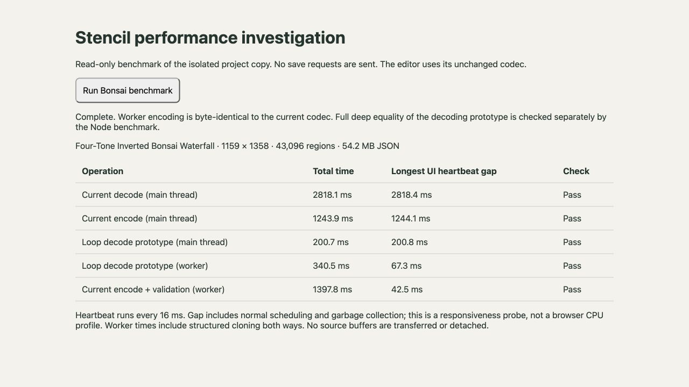

# Bonsai editor performance investigation

2026-11-10 · baseline commit `2995a59` · branch `codex/stencil-performance-investigation`

The recurring freezes have two confirmed causes: full-project serialization on the UI thread, and repeated native-resolution canvas scans/repaints. There is no need to reduce the artwork resolution to address either.

The user's editor on port 8765 and its project directory were left alone. Investigation used `/private/tmp/adeptus-mechanicus-performance`, port 8767, and a separate disk copy of the project. Production editor files in this branch remain unchanged; the candidate codec and worker live under `stencil-app/dist/performance/` and are used only by the diagnostic page. The repaint experiment is supplied as a separate patch.

## Why this project exposes the problem

The snapshot of **Four-Tone Inverted Bonsai Waterfall** has 1,159 × 1,358 pixels (1,573,922), 43,096 segmented regions, and approximately 54.2 MB of project JSON. Minimum-size filtering and cleanup are disabled. Every save includes source pixels, region maps, comparison data, smoothed pixels, and assignments, even when only the camera changes.

`viewport.mjs:13` calls `onChange()` for camera movement. `project-ui.mjs:9` debounces that into a save after 650 ms, and `projects.mjs:6` encodes the entire project synchronously. `await store.put(...)` does not make its preceding validation/encoding asynchronous: the browser cannot process input while those functions run.

This explains a characteristic pattern: zoom/pan responds, then the editor freezes shortly after movement stops. The disk request subsequently waits for server decoding/validation and durable writing too, but that server work is a different issue from blocking browser input.

## Measurements

Local in-app browser, one focused run per experiment; these are indicative measurements, not statistical percentiles. Temporary function timers and a 100 ms event-loop heartbeat were removed after collecting the editor results.

| Editor action | Observed main-thread work/pause |
| --- | ---: |
| Open saved Bonsai project | 4,319 ms event-loop stall, including 2,855 ms decoding plus restoration/rendering |
| Zoom once, then autosave | 1,396 ms event-loop stall; 1,239 ms encoding plus validation/snapshot overhead |
| Select Intensity 3 union | 145 ms painting selection + 27 ms refreshing controls |
| Reassign Intensity 3 union to Intensity 2 | 837 ms in assignment `changed()`, before the later autosave |
| Same reassignment with duplicate repaint removed | 473 ms in `changed()` (about 44% less time in this trial) |

The assignment comparison used the same copied assignments, treatment change, dimensions, and display settings. The test edit was undone afterward.

The standalone [browser benchmark](../stencil-app/dist/performance/index.html) isolates serialization from editor restoration and network/disk saving. It sends only GET requests to project storage. Worker results include cloning into/out of the worker; live source buffers are never transferred or detached.

| Serialization experiment | Total time | Longest UI heartbeat gap |
| --- | ---: | ---: |
| Current decoding on UI thread | 2,818 ms | 2,818 ms |
| Current encoding on UI thread | 1,244 ms | 1,244 ms |
| Loop decoder prototype on UI thread | 201 ms | 201 ms |
| Loop decoder prototype in worker | 341 ms | 67 ms |
| Current encoding + validation in worker | 1,398 ms | 43 ms |

The heartbeat runs every 16 ms. Its largest observed gap includes ordinary scheduling and garbage collection, not just application CPU time. Moving work to a worker keeps the UI available; it does not eliminate CPU work or guarantee 60 fps. The worker save experiment checks byte-identical output against the current encoder.



An independent Node check on the copied project measured current decode at 3,427 ms versus 375 ms for the loop prototype. Deep equality of every decoded field/typed array, and identical re-encoding, passed.

## Recommended fix, in small stages

1. **Move project encoding/decoding and validation into a reusable worker.** Keep the existing JSON format, disk autosave, single pending-save ordering, save-error handling, and explicit flush before opening/creating another project. Route loading, autosave, export/import, and migration through the same async codec where applicable. Pair this with the faster decoder below, also usable by the server. This directly addresses multi-second pauses after navigation and on opening projects.

   A worker is a background JavaScript thread: the UI can handle a pointer event while the worker packs the large project. Clone a consistent snapshot; never detach the editor's arrays. Keep request IDs/generation checks, cancellation, and error propagation. The diagnostic worker is a proof of concept, **not** a production save-queue implementation.

2. **Remove the duplicate repaint and cache assignment summaries.** `assign-ui.mjs:150` calls `cleanup.clear()`, which unconditionally calls `repaint()` in `assignment-cleanup-ui.mjs:11`; `changed()` then paints the same overlay, hints, boundaries and selection again. Allow that call site to clear a preview without painting, then render once with the new assignments. The tested [candidate patch](../stencil-app/diagnostics/remove-duplicate-repaint.patch) does exactly this; other clear callers retain their repaint behavior. Also compute the assigned-pixel count when assignments change instead of rescanning 1.57 million pixels on every selection/tool-control update (`assign-ui.mjs:56`).

3. **Make interactive painting incremental.** `paintOverlay()`, `paintHints()` and `paintSelection()` scan the full image. In this project a single overlay paint took about 139 ms and hints about 65 ms. `extendStroke()` requests those full paints whenever a brush move adds regions; it is not coalesced to an animation frame. Coalesce pointer updates with `requestAnimationFrame`, update only affected bounds/tiles for brush strokes, and cache reusable treatment/region selection masks by assignment revision. Preserve effective pixel overrides, transparency, treatment unions, layer visibility and undo invalidation. Large treatment-wide reassignments will still need larger updates.

Later, split immutable source/segmentation data from small changing camera/settings/assignment records so a camera change does not rewrite 54 MB. That is a larger storage/schema change and should follow the smaller, format-compatible fixes. Do not disable autosave or silently downsample to mask these problems.

### Faster decoding algorithm

The current decoder uses a JSON reviver for the whole object tree and `Uint8Array.from(atob(data), callback)` to copy binary strings. The prototype parses JSON normally, then walks ordinary objects/arrays; when it finds a typed-array wrapper, it decodes its bytes with a tight indexed loop (or a native typed-array decoder when available). This avoids tens of millions of callback calls. It then runs the existing project validation. The source pixels, segmentation and file format stay the same.

## Reproduce and validation

Start the isolated instance from its worktree:

```sh
env PORT=8767 node stencil-app/server.mjs
```

Open `http://127.0.0.1:8767/performance/index.html` and run the Bonsai benchmark. The page looks up that project by name and does not write projects. Avoid profiling while another heavy geometry job is running.

Read-only Node benchmark (explicit copied input):

```sh
node stencil-app/diagnostics/benchmark-project.mjs /private/tmp/bonsai-performance-snapshot.stencil.json
node --test stencil-app/tests/performance-codec.test.mjs
```

Two focused tests pass: all existing supported typed-array types, nested fields, binary byte values/subviews, non-finite float payloads, exact re-encoding, malformed input, and retained project validation. `git apply --check stencil-app/diagnostics/remove-duplicate-repaint.patch` passes against the baseline. No full suite was run.

This investigation does not certify worker save lifecycle/race handling, memory behavior on iPad, continuous stroke performance, vector tracing/export performance, or every rendering option. Those should be checked for the corresponding production implementation. Background encoding still clones a large snapshot and uses extra memory. The 473 ms assignment update is still too slow for drawing; the incremental rendering stage remains necessary.
